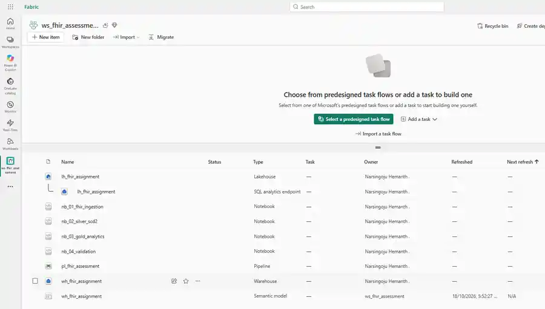
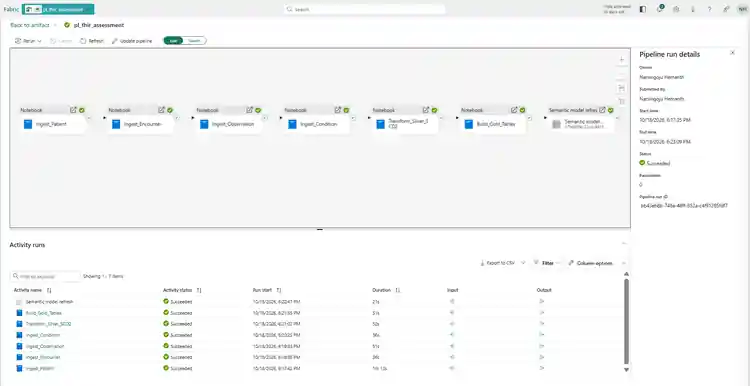
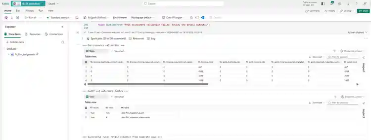
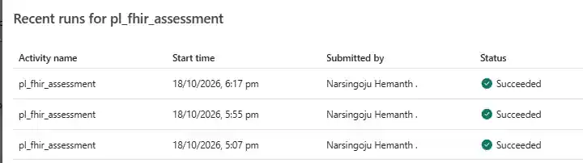
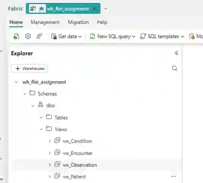
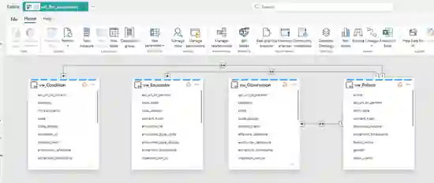
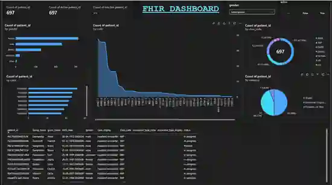

# FHIR API Ingestion and Analytics

I built this project in Microsoft Fabric to ingest FHIR R4 data from the public HAPI FHIR API, retain the source responses, track resource versions, and expose the data through Warehouse views and a Power BI report.

## 1. Solution overview

The assignment covered four FHIR resource types: **Patient, Encounter, Observation, and Condition**. I used a Raw → Bronze → Silver → Gold design so the original API responses are retained separately from the cleaned and reporting-ready data.

```text
HAPI FHIR R4
    |
    v
Raw response files + request metadata
    |
    v
Bronze Delta tables
    |
    v
Silver Delta tables with SCD Type 2
    |
    v
Gold analytical tables
    |
    v
Warehouse views -> Power BI semantic model -> report
```

| Layer | What it contains | Why I used it |
|---|---|---|
| Raw | Original paginated FHIR Bundle response bodies, arranged by resource, extraction date, and run ID | Keeps the source response available for traceability |
| Bronze | One Delta table for each resource type | Stores resource JSON, IDs, content hashes, and ingestion metadata |
| Silver | Cleaned and deduplicated versions of each resource | Retains prior versions when different resource content is observed |
| Gold | Reporting fields extracted from the current Silver version | Makes the FHIR fields easier to use in analytics |
| Warehouse | Four SQL views over the Gold tables | Exposes the final fields without maintaining a second copy of Gold data |
| Power BI | A semantic model and report built from the views | Allows demographic and resource-level exploration |

## 2. Main design decisions

- **One reusable ingestion notebook:** I use the same notebook for all four resources and pass `resource_type` from the pipeline. This keeps the API handling and metadata logic in one place.
- **Follow API pagination links:** The notebook follows the server-provided Bundle `next` link instead of constructing page offsets.
- **Keep Raw responses unchanged:** The response body is saved separately from its metadata sidecar, so the stored file is the original response body rather than JSON reconstructed from parsed objects.
- **Use content hashes for idempotency:** Bronze merge keys include resource type, resource ID, and content hash. Re-reading identical content does not create duplicate versions.
- **Keep version history in Silver:** Distinct observed payload versions are retained with `valid_from`, `valid_to`, and `is_current`.
- **Expose Gold through views:** Gold stays in the Lakehouse. The Warehouse views reference Gold, which avoids a second set of copied reporting tables.
- **Validate after the production pipeline:** The validation notebook runs separately so the pipeline can keep the required load order and validation can be inspected on demand.

## 3. Fabric items

The workspace contains:

| Item | Purpose |
|---|---|
| `lh_fhir_assignment` | Lakehouse for Raw files and Bronze, Silver, Gold, and control tables |
| `wh_fhir_assignment` | Warehouse containing the four Gold-facing SQL views |
| `nb_01_fhir_ingestion` | Paginated API ingestion, Raw persistence, Bronze merge, audit and watermark updates |
| `nb_02_silver_scd2` | Cleans and deduplicates Bronze data and builds Silver version history |
| `nb_03_gold_analytics` | Builds current-state analytical tables in Gold |
| `nb_04_validation` | Checks metadata, duplicates, version intervals, Gold IDs, Raw sidecars, audit and watermarks |
| `pl_fhir_assessment` | Sequential orchestration of ingestion and transformation, followed by semantic model refresh |
| `wh_fhir_assignment` semantic model | Model used for the Power BI report |

## 4. Pipeline execution order

I configured the pipeline with **On success** dependencies in this order:

1. `Ingest_Patient` — `nb_01_fhir_ingestion`, parameter `resource_type = Patient`
2. `Ingest_Encounter` — same notebook, parameter `resource_type = Encounter`
3. `Ingest_Observation` — same notebook, parameter `resource_type = Observation`
4. `Ingest_Condition` — same notebook, parameter `resource_type = Condition`
5. `Transform_Silver_SCD2` — `nb_02_silver_scd2`
6. `Build_Gold_Tables` — `nb_03_gold_analytics`
7. `Semantic model refresh` — refreshes the semantic model after Gold is built

The first notebook's configuration cell is marked as a Fabric parameter cell. Its defaults are `initial_lookback_days = 3`, `page_size = 100`, `overlap_minutes = 5`, and `max_pages = 1000`. The pipeline overrides `resource_type` for the first four activities.

After a successful pipeline run, I run `nb_04_validation` separately. The validation notebook is not inserted into the production chain.

## 5. Notebook responsibilities

### `nb_01_fhir_ingestion.ipynb`

Calls the HAPI FHIR R4 API for the selected resource, follows pagination, saves each successful response under a resource/date/run folder, writes request metadata to a sidecar and audit table, then merges individual resources into Bronze. It records API-call and save timestamps and maintains a resource-specific source watermark.

Raw folder pattern:

```text
Files/raw/fhir/
  resource=Patient/
    extraction_date=YYYY-MM-DD/
      run_id=.../
        page_00001.json
        page_00001.metadata.json
```

The same layout is used for Encounter, Observation, and Condition.

### `nb_02_silver_scd2.ipynb`

Reads all four Bronze tables, filters invalid rows, removes repeated copies of identical payload versions, and builds the Silver tables. It calculates version intervals and marks the latest observed version current.

### `nb_03_gold_analytics.ipynb`

Extracts fields used in reporting from the current Silver versions into `gold.Patient`, `gold.Encounter`, `gold.Observation`, and `gold.Condition`. Source and ingestion metadata is retained with the analytical fields.

### `nb_04_validation.ipynb`

Checks the four resource layers, required metadata, duplicate content versions, Silver current-version counts and interval validity, Gold IDs, Raw response/sidecar counts, audit rows, and watermarks. The recorded validation result was **`OVERALL: PASS`**.

## 6. Tables and metadata

| Layer | Tables |
|---|---|
| Bronze | `bronze.Patient`, `bronze.Encounter`, `bronze.Observation`, `bronze.Condition` |
| Silver | `silver.Patient`, `silver.Encounter`, `silver.Observation`, `silver.Condition` |
| Gold | `gold.Patient`, `gold.Encounter`, `gold.Observation`, `gold.Condition` |
| Control | `dbo.fhir_ingestion_audit`, `dbo.fhir_ingestion_watermarks` |

The main metadata fields are:

- `extraction_timestamp` — extraction time.
- `api_url_or_params` — actual requested URL, including API-provided pagination links.
- `api_call_timestamp` — request start time, persisted in audit and Raw sidecar metadata.
- `saved_timestamp` — time after the Raw response was saved.
- `source_last_updated` — FHIR `meta.lastUpdated`, when supplied.
- `content_hash` — hash used to identify distinct resource payload versions.
- `ingestion_run_id` — joins a resource version back to its ingestion run.

The two control tables track per-page outcomes and per-resource watermarks. The watermark only advances after a completed successful scan under the notebook's defined rules.

## 7. Warehouse views

The SQL script is in [`warehouse/create_gold_views.sql`](warehouse/create_gold_views.sql). It creates these views in `wh_fhir_assignment`:

| View | Data |
|---|---|
| `dbo.vw_Patient` | Patient demographics and status |
| `dbo.vw_Encounter` | Encounter status, class, subject, and period |
| `dbo.vw_Observation` | Observation code, category, value, and effective time |
| `dbo.vw_Condition` | Condition status, code, subject, and recorded/onset dates |

The views filter to the current Gold row and reference the Lakehouse Gold tables directly. The script can be run again to update the definitions.

## 8. Power BI semantic model and report

I created the semantic model from the four Warehouse views and used `patient_id` to relate the Patient table to the three resource tables.

| One side | Many side | Cardinality | Filter direction |
|---|---|---|---|
| `vw_Patient[patient_id]` | `vw_Encounter[patient_id]` | 1:* | Single, Patient → Encounter |
| `vw_Patient[patient_id]` | `vw_Observation[patient_id]` | 1:* | Single, Patient → Observation |
| `vw_Patient[patient_id]` | `vw_Condition[patient_id]` | 1:* | Single, Patient → Condition |

The report includes patient overview cards and filters, demographic breakdowns, distributions by resource code/category/class, and a resource detail table. The public HAPI data is a changing sample, so counts and categories can change between runs. The report is for demonstrating ingestion and analytics, not for clinical decision-making.

## 9. How to reproduce the project

1. Create a Fabric workspace with a **schema-enabled** Lakehouse named `lh_fhir_assignment` and a Warehouse named `wh_fhir_assignment`.
2. Import the four notebooks from `notebooks/` and attach the Lakehouse as the default Lakehouse for each notebook.
3. Mark the first cell in `nb_01_fhir_ingestion` as its notebook parameter cell.
4. Create `pl_fhir_assessment` using the seven activities and parameters shown in Section 4.
5. Run the pipeline. If Spark capacity is busy, wait for capacity to free up before retrying; the HTTP 430 `TooManyRequestsForCapacity` error is a capacity limit, not by itself a code failure.
6. Run `nb_04_validation` and check the final `OVERALL` result.
7. Open `wh_fhir_assignment`, add the Lakehouse SQL analytics endpoint through **+ Warehouses**, and execute `warehouse/create_gold_views.sql`.
8. Create the semantic model from the four views, set the three relationships in Section 8, and build the report.
9. Keep the project source in GitHub. Do not commit raw FHIR response payloads, extracted datasets, credentials, or tokens.

## 10. Run evidence

The screenshots below are from the Fabric workspace and report.

### Workspace items



### Successful end-to-end pipeline

The captured successful run completed all four ingestion activities, Silver, Gold, and semantic model refresh.



### Validation output

The validation output returned `OVERALL: PASS`. At the captured run, the resource table counts were Patient 697, Encounter 4,365, Observation 4,549, and Condition 1,936; the audit table contained 125 rows and the watermark table contained four resource checkpoints. Counts can change as the public API changes.



### Run history

The validation output above includes the audit table and four resource watermarks. The run-history screenshot shows three successful pipeline runs on **18 October 2026**. These prove repeated successful execution on that date; they do **not** prove runs on three separate calendar days.



### Warehouse views



### Semantic model



### Power BI report



## 11. Repository contents

```text
README.md
.gitignore
notebooks/
  nb_01_fhir_ingestion.ipynb
  nb_02_silver_scd2.ipynb
  nb_03_gold_analytics.ipynb
  nb_04_validation.ipynb
warehouse/
  create_gold_views.sql
evidence/
  screenshots of the Fabric workspace, pipeline, validation, Warehouse, model, and report
```

I kept the repository to the files needed to understand and reproduce the solution. The actual pipeline and report are Fabric workspace items; the notebooks, Warehouse SQL, setup steps, data flow, model mapping, and run evidence are documented here.
